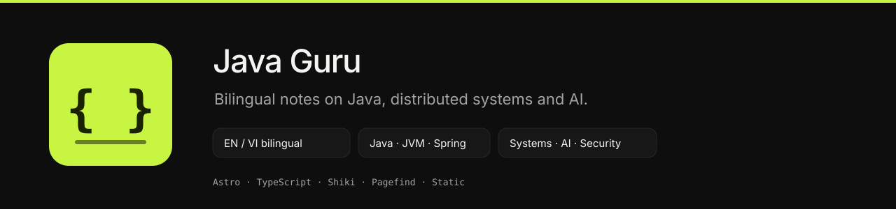

<p align="center">
  <picture>
    <source media="(prefers-color-scheme: light)" srcset="docs/assets/banner-light.svg">
    
  </picture>
</p>

<h1 align="center">Java Guru</h1>

<p align="center">
  <strong>Bilingual notes on Java, distributed systems and AI.</strong><br>
  Every article is published in Vietnamese and English — static, self-hosted, no tracking, no backend.
</p>

<p align="center">
  
  
  
  
  
  
  
  
</p>

<p align="center">
  <a href="https://java-guru.pages.dev/"><strong>Live demo</strong></a> ·
  <a href="#quick-start">Quick start</a> ·
  <a href="#design-system">Design system</a> ·
  <a href="#documentation">Documentation</a>
</p>

---

## Stack

| Concern      | Choice                                                           |
| ------------ | ---------------------------------------------------------------- |
| Framework    | [Astro](https://astro.build) 5, fully static                     |
| Language     | TypeScript (strict)                                              |
| Styling      | Tailwind CSS 4 + a hand-written prose layer                      |
| Content      | Content Collections — `src/content/posts/<slug>/{vi,en}.md`      |
| Highlighting | [Shiki](https://shiki.style) — one custom palette token set      |
| Search       | [Pagefind](https://pagefind.app) — one index, filtered by locale |
| Icons        | [Lucide](https://lucide.dev) (`@lucide/astro`)                   |
| Fonts        | Self-hosted Geist + Geist Mono, with Inter/JetBrains fallbacks   |
| Deployment   | Cloudflare Pages (primary) · Docker + Caddy (alternative)        |

No database, no runtime server, no client framework.

## Quick start

```bash
pnpm install
pnpm dev            # http://localhost:4321 → redirects to /en/
pnpm build          # static build + Pagefind index
pnpm preview        # preview the production build
```

Node 20.19+ and pnpm 10 (`corepack enable` is enough).

### Scripts

| Script                       | What it does                                                             |
| ---------------------------- | ------------------------------------------------------------------------ |
| `pnpm dev`                   | Dev server with HMR                                                      |
| `pnpm build`                 | `astro build`, then Pagefind (`--force-language en`, filtered by locale) |
| `pnpm preview`               | Serve the built site                                                     |
| `pnpm check`                 | `astro check` — types and Astro diagnostics                              |
| `pnpm lint` / `pnpm format`  | ESLint / Prettier                                                        |
| `pnpm validate`              | Bilingual content gate: locale parity, code blocks, links, structure     |
| `pnpm check:disclosures`     | Fails if the build exposes content-source metadata                       |
| `pnpm fonts` / `pnpm assets` | Regenerate fonts / avatar, favicons, OG image                            |

## Project structure

```text
java-guru/
├── deploy/
│   ├── Caddyfile                 # container web server + legacy redirects
│   └── nginx.conf                # alternative host config (example)
├── docs/deployment.md            # Cloudflare Pages, Docker, TLS, rollback
├── public/
│   ├── _redirects                # legacy URL → /en/… (Cloudflare Pages)
│   ├── fonts/                    # self-hosted Geist + fallback woff2
│   ├── images/articles/<slug>/   # inline figures
│   └── favicon/, favicon.svg, site.webmanifest
├── scripts/
│   ├── validate-content.mjs      # bilingual QA
│   ├── check-disclosures.mjs     # publication hygiene
│   ├── fonts.mjs
│   └── prepare-assets.mjs
├── src/
│   ├── components/{layout,blog,article,navigation,common}/
│   ├── content/posts/<slug>/     # vi.md · en.md · cover.png
│   ├── data/{categories,projects}.ts
│   ├── i18n/{config,ui}.ts       # locales + interface copy
│   ├── layouts/                  # BaseLayout, PostLayout
│   ├── pages/
│   │   ├── index.astro           # locale-preference redirect
│   │   ├── [...locale]/          # every localized route
│   │   └── robots.txt.ts
│   ├── styles/                   # global.css (tokens), fonts.css
│   └── utils/                    # posts, i18n paths/dates, rehype plugins
├── astro.config.ts
├── Dockerfile / docker-compose.yml / .env.example
└── README.md
```

## URL structure

```text
/            → sends first-time visitors to /en/, returning ones to their choice
/en/         /vi/
/en/posts/   /vi/posts/            (paginated: /posts/2/)
/en/posts/<slug>/                  same slug in both locales
/en/categories/  /en/categories/<slug>/
/en/tags/        /en/tags/<slug>/
/en/collection/                    curated reading library
/en/collection/blogs/              the Blogs shelf
/en/collection/blogs/<id>/         one curated article
/en/archives/  /en/about/  /en/projects/  /en/homelab/  /en/search/
/en/rss.xml      /vi/rss.xml
```

Legacy single-language URLs (`/posts/…`, `/about`, `/rss.xml`, …) 301 to their
`/en/` equivalents — configured in `public/_redirects` (Cloudflare Pages) and in
`deploy/Caddyfile` (Docker).

## Content

### Adding an article

```
src/content/posts/<slug>/
├── vi.md        # Vietnamese version
├── en.md        # English version
└── cover.png    # optional cover, referenced as ./cover.png
```

Frontmatter (identical in both files except `title`, `description`, `locale`,
`readingTime`):

```yaml
---
title: "Hiểu Saga Pattern trong 5 phút"
description: "Một câu mô tả lấy từ đoạn mở đầu của bài."
slug: "hieu-saga-pattern-trong-5-phut"
locale: "vi" # "vi" in vi.md, "en" in en.md
translationKey: "hieu-saga-pattern-trong-5-phut"
pubDate: 2025-09-02T18:59:56+07:00
category: "Microservices"
tags: ["saga pattern", "System Design"]
featured: true
draft: false
readingTime: 9
series: null
coverImage: "./cover.png"
---
```

Rules enforced by the schema and the validator:

- `slug` must equal the folder name and `translationKey` (it is what the language
  switcher resolves).
- `category` must be one of the canonical keys in `src/data/categories.ts`
  (display labels are localized there).
- `tags` are shared across both locales.
- Inline figures live in `public/images/articles/<slug>/` and are referenced by
  absolute path, e.g. `/images/articles/<slug>/figure-1.png`.

### Adding a translation

1. Create `en.md` next to `vi.md` with the same `slug`/`translationKey`,
   `locale: "en"`, and translated `title`/`description`.
2. Translate the body only. Code fences, commands, config, identifiers, URLs and
   image paths stay byte-identical; headings keep their count and levels.
3. Set `readingTime` for the translation (≈220 words/minute).
4. Run `pnpm validate`.

### Content validation

`pnpm validate` walks every article folder and fails the build when:

- a locale file is missing, empty, or missing required metadata;
- `slug` / `translationKey` / `category` / `pubDate` / `coverImage` / `tags`
  disagree between locales;
- a fenced code block differs (count, language tag, or body);
- a link target or image path was lost;
- heading structure or table shape changed;
- the translation is implausibly short or long (length-ratio sanity check).

## Design system

A flat black-and-white palette with one lime accent, shared with DevShelf. The
five existing theme IDs are kept for stored preferences; the four dark themes use
the dark token set and `daylight` uses the light token set.

| Theme                 | Mode  | Background | Accent    |
| --------------------- | ----- | ---------- | --------- |
| Tokyo Night (default) | dark  | `#0e0e0e`  | `#c8f542` |
| Catppuccin Mocha      | dark  | `#0e0e0e`  | `#c8f542` |
| Nord                  | dark  | `#0e0e0e`  | `#c8f542` |
| Gruvbox               | dark  | `#0e0e0e`  | `#c8f542` |
| Daylight              | light | `#fafaf7`  | `#4d7c0f` |

- Fonts are self-hosted Geist (UI/headings) and Geist Mono (labels/code), with
  Inter and JetBrains Mono as Vietnamese/glyph fallbacks.
- Surfaces use 1px `#262626`/`#e7e7e2` borders and 12–16px radii; no shadows,
  gradients or glow. Selection and focus use the lime accent.
- The theme is applied by an inline script **before first paint** (no flash) and
  stored in `localStorage` under `jg-theme`. `<meta name="theme-color">` and the
  web manifest follow the active palette.
- `src/utils/rehype-code.ts` renders each code block once with a custom Shiki
  theme whose token colours match the accent palette; CSS maps the theme
  variables onto the active surface. No client highlighter.

### Adding a theme

1. Append to `THEMES` in `src/config.ts`.
2. Add an `html[data-theme="<id>"]` block in `src/styles/global.css` with the full
   token contract (`--bg`, `--fg`, `--primary`, `--lime`, `--selection`, …).
3. Add swatches in `src/components/navigation/ThemePicker.astro` and the allowed
   list in `src/layouts/BaseLayout.astro`.

## Interface localisation

`src/i18n/ui.ts` holds every string the chrome renders, typed against the English
dictionary so a missing Vietnamese key fails `pnpm check`. Dates use
`Intl.DateTimeFormat` with `vi-VN` / `en-GB`; reading time, empty states, search
labels, pagination and error pages are all localized.

The language switcher preserves the current page: on an article it links to the
sibling translation (`/vi/posts/<slug>/` ↔ `/en/posts/<slug>/`); elsewhere it
swaps the locale prefix of the same route.

## Search

Pagefind indexes article bodies only (`data-pagefind-body` on the prose
container). Each page carries a `locale` filter, so the UI can offer:

- **This language** — results in the language you are reading;
- **All languages** — both editions, clearly separated by URL.

Available from the header dialog (⌘K / Ctrl-K) and `/en/search/` · `/vi/search/`.

## Engineering Collection

`/en/collection/` is a curated library of **external** engineering writing — system
design, distributed systems, databases, infrastructure, reliability and security.
It is not a publishing surface: every entry links out, and the site never stores
the full article.

Only **Blogs** is implemented. Books, Videos, Courses, Papers and Repositories are
listed as planned shelves without routes, so there are no empty pages to land on.

### Adding an article

Everything lives in one file: [`src/data/engineering-blogs.json`](src/data/engineering-blogs.json).

```json
{
  "id": "canva-session-revocations",
  "title": "Session revocations at scale",
  "company": "Canva",
  "url": "https://www.canva.dev/blog/engineering/session-revocations-at-scale/",
  "publishedAt": "2026-07-22",
  "description": "One or two sentences, editorial.",
  "descriptionVi": "Bản tiếng Việt của mô tả.",
  "topics": ["Distributed Systems", "Security", "System Design"],
  "readingTime": 12,
  "featured": true,
  "editorNote": "Why this one is worth the reader's time.",
  "editorNoteVi": "Vì sao bài này đáng thời gian của người đọc.",
  "takeaways": ["Optional, three short lines."],
  "takeawaysVi": ["Không bắt buộc, ba dòng ngắn."]
}
```

`src/data/engineering-collection.ts` validates every entry **at build time** and
fails loudly on a duplicate id, unknown company/topic, non-https URL, malformed
date, or mismatched EN/VI takeaway count. Counts, filters and sorting are derived;
no component edits are needed to add an article.

Rules the data follows:

- `company` is one of the keys in `COMPANY_KEYS`; use `"Other"` plus
  `"companyName": "Figma"` for a brand outside the named list.
- `topics` must come from `TOPIC_KEYS` (the ten topics the filters expose).
- `publishedAt` is the date shown on the source page, `YYYY-MM-DD`.
- `readingTime` is included only when the source publishes one — never estimated.
- Descriptions and notes are written for this collection; titles, dates and links
  belong to the original publisher.

Filtering, search and sorting run entirely in the browser over server-rendered
cards, so the page works without JavaScript (all entries stay visible) and needs
no API.

## Deployment

### Cloudflare Pages (primary)

Connected to this repository. Build settings:

| Setting          | Value                          |
| ---------------- | ------------------------------ |
| Build command    | `pnpm build`                   |
| Output directory | `dist`                         |
| Node version     | 22 (env var `NODE_VERSION=22`) |

`public/_redirects` is copied into `dist` and applied automatically.

### Docker

```bash
cp .env.example .env      # set SITE_URL
docker compose up -d --build
```

Full instructions — TLS with a host Caddy/Nginx, health checks, rollback,
troubleshooting — are in [`docs/deployment.md`](docs/deployment.md).

## Documentation

|                  |                                                                                                                                                                      |
| ---------------- | -------------------------------------------------------------------------------------------------------------------------------------------------------------------- |
| **Using it**     | [Live demo](https://java-guru.pages.dev/) · [Content & translations](#content) · [Design system](#design-system) · [Interface localisation](#interface-localisation) |
| **Running it**   | [Deployment](docs/deployment.md) · [Quick start](#quick-start) · [URL structure](#url-structure)                                                                     |
| **Extending it** | [Engineering Collection](#engineering-collection) · [Adding a theme](#adding-a-theme) · [Scripts](#scripts)                                                          |

## Licence

- Article text and images © Hưng Phạm.
- Code in this repository is MIT licensed (see `LICENSE`).

Built with Astro, Shiki, Pagefind, Tailwind CSS, Lucide and Caddy.
